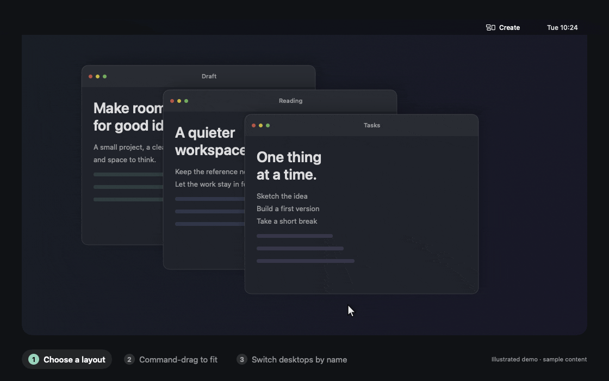
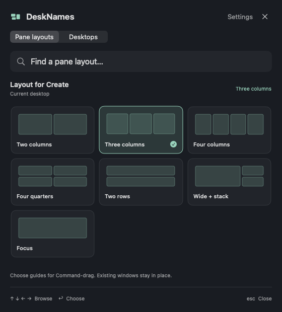

<div align="center">

# DeskNames

**Give every desktop a name. Give every window a place.**

A quiet macOS menu-bar utility for named desktops, visual pane layouts, and remembered window arrangements.

**Apple Silicon · macOS 14+ · Free and open source (MIT)**

[**Download for Mac**](https://github.com/Kipung/DeskNames/releases/tag/v0.6.0) · [Install with Homebrew](#install) · [User guide](README.txt) · [Report a bug](https://github.com/Kipung/DeskNames/issues)



<sub>Illustrated demo with fictional sample windows, drawn with DeskNames’ own pane geometry. Not a screen recording. <a href="docs/media/panes-demo.mp4">MP4 version</a>.<br>0.6.0 is an unnotarized public preview. See <a href="#install">Install</a> before first launch.</sub>

</div>

## What it does

DeskNames lives in the menu bar. Open its compact panel to pick a pane layout for the current desktop, or switch to another desktop by name. Search, click, or use the arrow keys and Return. The full settings window opens only when you ask for it.

- **Seven pane layouts:** two, three, or four columns; quarters; rows; wide + stack; and focus.
- **Command-drag to fit:** choose a guide, drag a window, and release the mouse before Command. Per-desktop spacing includes an edge-to-edge option.
- **Resize neighbors together:** an optional shared divider adjusts windows on both sides.
- **Name your desktops:** names and colors follow Space identities, with labels in expanded Mission Control.
- **Remember arrangements:** save where every window sits on a desktop, including overlap order, and put them all back in one step after things get messy. Restores can run automatically when you enter a desktop. Optional routing sends a newly opened window to its chosen desktop once.
- **Keep control:** shortcuts, edge snapping, routing, and automatic updates are configurable. Existing shortcut bindings survive upgrades.

### Keyboard shortcuts

Shortcuts start **off**. Turn them on in **Settings → Keyboard shortcuts**, and use the **Add suggested** buttons for the window and pane shortcuts. Suggestions never replace bindings you already set.

| Action | Suggested shortcut |
| --- | --- |
| Open the DeskNames panel | ⌃⌥⌘ Space |
| Save / restore this desktop’s arrangement | ⌃⌥S / ⌃⌥R |
| Go to desktop 1–9 | ⌃⌥1 … ⌃⌥9 |
| Left / right / top / bottom half | ⌃⌥← / → / ↑ / ↓ |
| Quarters | ⌃⌥U, I, J, K |
| Thirds | ⌃⌥⇧1, 2, 3 |
| Maximize / center / restore previous size | ⌃⌥↩ / ⌃⌥C / ⌃⌥⌫ |
| Move the window into pane 1–4 | ⌃⌥F1 … F4 |
| Previous / next pane layout | ⌃⌥[ / ⌃⌥] |

Every binding can be changed. The [user guide](README.txt) lists them all.

> [!NOTE]
> Selecting a pane preset changes the guides; it does not rearrange every open window at once. The separate tiling and restore commands handle arrangements.

<p align="center"></p>

<p align="center"><sub>The actual control panel, rendered with fictional sample data.</sub></p>

## Install

> [!IMPORTANT]
> **0.6.0 is an unnotarized public preview.** It is ad-hoc signed, not Developer ID signed or notarized by Apple, so macOS may block first launch. Review [Apple’s guidance for opening downloaded apps](https://support.apple.com/en-us/102445); DeskNames does not disable Gatekeeper or remove quarantine. Updating may require renewing its Accessibility approval.
>
> The download is **Apple Silicon only**. Intel Macs are not supported.

### Option 1: Homebrew

```sh
brew install --cask kipung/desknames/desknames
```

The [tap](https://github.com/Kipung/homebrew-desknames) pins the release archive’s SHA-256. This is a project-maintained tap, not a listing in Homebrew’s official cask repository.

### Option 2: Direct download

1. Download [DeskNames-0.6.0-arm64.zip](https://github.com/Kipung/DeskNames/releases/download/v0.6.0/DeskNames-0.6.0-arm64.zip).
2. Unzip it and drag **DeskNames.app** into **Applications**.

Release assets include checksums. No account or subscription is required.

### First launch

1. Open DeskNames, then click its menu-bar icon. It starts without a full app window.
2. Choose **Settings** and enable DeskNames in **System Settings → Privacy & Security → Accessibility** for window management.
3. Optional: in **Keyboard shortcuts**, enable global shortcuts to open the panel with **Control–Option–Command–Space**. Shortcuts start off so DeskNames does not take over existing bindings.

If window controls stay disabled after an update, macOS may be holding a stale Accessibility approval. Toggling it alone may not help; resetting DeskNames’ Accessibility approval and adding the installed app again resolved it in testing.

The [0.6.0 validation report](docs/release-0.6.0-validation.md) covers the tested Homebrew installation, signed updater installation/relaunch, and remaining limits.

## Updates

The control panel includes **Check for Updates…**, **Check automatically**, and **Download and install updates automatically**. Background checks and automatic installation **start off**; enable the behavior you want.

Updates use [Sparkle](https://sparkle-project.org/). Both the feed and archives are verified with the embedded Ed25519 public key, and downloads use HTTPS. Update signing is separate from Apple notarization: this preview is still unnotarized after an update. Builds from before the updater was added need a one-time manual upgrade.

Homebrew users can also run:

```sh
brew update
brew upgrade --cask desknames
```

## Privacy

- Desktop names, shortcuts, pane preferences, rules, and saved arrangements stay on your Mac.
- No accounts or analytics. DeskNames does not request Screen Recording permission.
- Network use is limited to updates: checks contact GitHub for the feed, and downloads use GitHub release hosting. Sparkle’s optional system-profile reporting is disabled. Window titles, desktop names, and layout files are not sent with update checks.

The screenshot uses the real panel with fictional fixture data; the GIF and MP4 are illustrated demos generated offscreen from fictional content. [Download the MP4 demo](docs/media/panes-demo.mp4) or [reproduce the media](docs/releasing.md#sample-only-media).

## Compatibility and limitations

- **macOS version:** the deployment target is macOS 14, but current native validation is on macOS 26.6.2. That is not a claim that all functionality has been validated on every OS release.
- **Moving windows between desktops:** background window transfers use private macOS interfaces and are supported more narrowly; automatic routing refuses unsupported transfers.
- **Other apps:** apps can enforce minimum window sizes or reject Accessibility actions.
- **Displays:** multiple-monitor reconnects and identical-monitor arrangements still need broader physical testing.
- **Restoring layouts:** does not recreate closed documents or browser tabs.

## Build from source

Install Xcode’s command-line tools on an Apple Silicon Mac, then:

```sh
git clone https://github.com/Kipung/DeskNames.git
cd DeskNames
./build.sh
open build/DeskNames.app
```

The build script downloads a pinned, checksum-verified Sparkle framework and compiles the native Swift/AppKit/SwiftUI app. Local builds are ad-hoc signed by default. [Persistent development signing](docs/development-signing.md) is optional.

Run the self-test:

```sh
build/DeskNames.app/Contents/MacOS/DeskNames --self-test
```

The movement, pane, and layout session tests create disposable native windows and may briefly affect the display. See [validation notes](docs/validation.md) and [the contributor guide](CONTRIBUTING.md).

## Documentation

[Full user guide](README.txt) · [0.6.0 validation report](docs/release-0.6.0-validation.md) · [Architecture](docs/architecture.md) · [Release process](docs/releasing.md) · [Project context](PROJECT_CONTEXT.md)

## License

[MIT](LICENSE). Native bridge attribution for ferry and yabai, and Sparkle’s license, are preserved in [THIRD_PARTY_NOTICES.txt](THIRD_PARTY_NOTICES.txt) and the app bundle.
